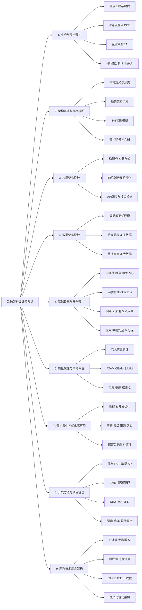

# 突击通关计划

> 资料网盘链接【https://www.alipan.com/s/HwQWNM39dMh】，提取码【7e4b】，客服 QQ：2679450097。

## 一、核心突击原则
- **不要看教材**：教材太厚，时间不够，只看真题和必背内容
- **不要做模拟题**：只做近3年真题，模拟题质量参差不齐
- **不要贪多**：已经放弃的内容就不要再看了，把时间花在能得分的地方
- **论文一定要背熟**：论文是你最容易得分的科目，也是最容易挂的科目
- **机考适应**：提前练习打字速度，确保120分钟能打完2500字
- 只学占分70%+的**超高频考点**，第二梯队只学近2年真题出现过的内容，第三梯队**100%放弃**
- **论文只准备2篇**：集中精力把2篇最可能考、你最擅长的练到滚瓜烂熟
- **案例分析只练4种题型**：其他题型直接放弃，考试时只选这4种

### 各科极致提分策略（目标每科55-58分）
#### 1. 综合知识（目标55分）

> [选择题技巧](./选择题技巧.md)

#### 2. 案例分析（目标55分）

> [案例分析题技巧-必答题](./案例分析题技巧-必答题.md)
> [案例分析题技巧-选答题](./案例分析题技巧-选答题.md)

- **必做题型**：架构风格选择、性能优化、安全问题、微服务设计
- **直接放弃题型**：嵌入式系统、硬件相关、复杂数学计算、项目管理
- **万能答题模板**（必须背下来）：
  - 架构选型题："我认为应该选择XX架构风格。优点：1. XX；2. XX；3. XX。缺点：XX。在本项目中，XX需求正好匹配其优点，而其缺点可以通过XX方式规避。"
  - 问题解决题："存在的问题：1. XX；2. XX；3. XX。解决方案：1. XX；2. XX；3. XX。预期效果：XX。"
  - 技术对比题："XX技术的优点是XX，缺点是XX，适用于XX场景；YY技术的优点是XX，缺点是XX，适用于XX场景。"
- **技巧**：
  - 先看问题，再读材料
  - 分点作答，每个要点一句话，不要长篇大论
  - 必答题一定要做，选答题只选上面4种题型

#### 3. 论文（目标55分，你的拉分项）

> [论文题技巧](./论文题技巧.md)

## 二、核心考点

#### 第一梯队（必做，目标正确率80%+，占分70%+）
看到以下任何一个关键词，直接标记为**第一梯队**，必须认真做、搞懂、背下来：
- 软件架构：架构风格、架构模式、4+1视图、质量属性、架构设计、架构描述
- 架构评估：ATAM、SAAM、效用树、风险点、敏感点、权衡点
- 分布式：CAP、BASE、缓存、Redis、分布式事务、TCC、SAGA、消息队列、Kafka、Raft
- 云原生：微服务、Kubernetes、K8s、容器、Docker、服务网格、Serverless、网关
- 数据库：ACID、隔离级别、索引、SQL优化、分库分表、读写分离、NoSQL
- 安全：XSS、CSRF、SQL注入、越权、OAuth2.0、JWT、RBAC、加密

#### 第二梯队（选做，目标正确率60%+，占分20%）
看到以下任何一个关键词，标记为**第二梯队**，只做2023-2025年的，做错了看答案记住即可，不用深究：
- 软件工程：开发模型、敏捷、瀑布、UML、用例图、类图、顺序图、需求工程
- 系统设计：可靠性、可用性、性能设计、容错、灾备
- 项目管理：进度管理、风险管理、成本管理（只做最简单的）

#### 第三梯队（直接放弃，蒙答案即可，占分10%）
看到以下任何一个关键词，**直接跳过**，考试时统一选B或C：
- 计算机组成原理、操作系统、嵌入式系统、硬件
- 计算机网络（除了HTTP/HTTPS）、TCP/IP、路由、交换
- 法律法规、知识产权、标准化
- 数学题、计算题（除了最简单的可用性计算）

#### 考点分类

## 三、考试基本信息
### 1. 考试时间与科目安排
- **10月24日（星期六）**
  - 上午8:30-12:30：综合知识+案例分析（连考，总时长240分钟，两科时间可灵活调配）
  - 下午14:30-16:30：论文写作（单独科目，120分钟，不得提前交卷）

### 2. 考试形式与合格标准
- **全部机考**，三科独立计分，**每科满分75分，45分合格**
- **必须三科同时通过**，任一科目未达标即整体不合格

### 3. 各科题型与分值分布
| 科目 | 题型 | 分值 | 核心考查内容 |
|------|------|------|--------------|
| 综合知识 | 75道单选题 | 75分 | 知识广度，覆盖计算机基础、架构理论、分布式系统、云原生、安全等 |
| 案例分析 | 1道必答题+4选2道主观题 | 75分 | 实践分析能力，聚焦架构选型、性能优化、高可用设计、分布式事务等 |
| 论文 | 4选1道命题写作 | 75分 | 架构表达能力，要求结合项目经验阐述设计思路，约2500字 |

## 四、每日精确可执行计划

### 第一阶段：核心搭建期（第1-7天，10.8-10.14）

核心目标
- 完成论文素材梳理与写作框架搭建
- 掌握案例分析标准化答题模板
- 综合知识过一遍高频考点

#### 1. 论文（约1-1.5小时/天）
- 第1-2天：提炼1个真实核心项目素材，整理成标准化素材卡：
    - 项目背景与规模（业务量级、用户量、投资量级）
    - 你的角色与核心职责
    - 项目面临的3个核心架构挑战
    - 关键技术选型与架构设计方案
    - 落地过程中的难点与对应解决方案
    - 最终上线效果与数据指标
- 第3-5天：基于项目素材，完成3个高频考试方向的论文初稿，分别是**微服务架构设计、分布式高可用架构、系统质量属性优化**，每篇控制在2200-2500字，做到「一个素材适配多个主题」。
- 第6-7天：打磨3篇初稿，优化摘要和核心设计段落，补充专业术语，突出你的个人决策与贡献；同时提炼每篇的核心框架，做成可背诵的要点提纲。
#### 2. 案例分析（约40分钟/天）
- 第1-2天：掌握标准化答题框架：**问题识别→原因分析→改进方案→效果评估**，所有答案必须分点作答，适配阅卷按点给分的规则。
- 第3-6天：每天突破1个高频题型，分别练习架构选型对比、性能优化、高可用设计、安全架构、质量属性评估（ATAM/SAAM），每道题做完对照标准答案复盘，补全得分点。
- 第7天：完成1套完整案例真题（必做题+选做题），限时90分钟，模拟考场节奏。
#### 3. 综合知识（约25分钟/天）
- 不啃教材，直接刷近3年真题，每天30-40道题，重点整理错题对应的知识点。
- 核心关注：软件架构设计、分布式系统、质量属性三大高分值模块，冷门考点（如嵌入式、法律法规）只记真题里出现过的。

### 第二阶段：强化练习期（第8-12天，10.15-10.19）

核心目标：
- 论文限时写作，熟练输出；
- 案例分析真题刷透，答题规范化；
- 综合知识查漏补缺。

#### 1. 论文
- 每两天完成1篇完整论文的限时写作，严格控制在120分钟内，适应机考打字节奏。
- 写完后按3个标准自查：是否紧扣题目所有子问题、是否有具体实践细节、结构是否完整字数是否达标。
- 每天背诵3篇论文的核心框架和关键段落，做到看到题目就能快速搭出骨架、填充内容。
#### 2. 案例分析
- 每天1道历年真题精做精析，把标准答案的得分点拆解成自己的答题话术，确保每个问题都用专业术语分点回答。
- 总结选做题策略：优先选自己熟悉的分布式/微服务/数据库方向，果断放弃不熟悉的嵌入式等领域。
#### 3. 综合知识
- 每天刷1套真题的错题对应的知识点，重点攻克薄弱模块，不用再大量做新题。
- 第12天上午完成1套完整真题，限时150分钟，测算分数，确认稳定在50分以上。

### 第三阶段：冲刺模拟期（第13-16天，10.20-10.23）

核心目标：
- 全真模拟考试节奏
- 巩固背诵内容
- 调整应试状态。

#### 1. 第13-14天：全真模拟
- 完全按照考试时间安排，上午连续完成综合知识+案例分析，下午写论文，全程不查资料、不中断，模拟机考环境。
- 考完后全面复盘：综合知识回顾错题，案例分析补全得分点，论文优化逻辑和表述。
#### 2. 第15天：查漏补缺
- 综合知识：过一遍所有错题和高频考点，不做新题。
- 案例分析：回看所有做过的真题答题框架，总结通用话术。
- 论文：再过一遍3篇论文的结构和核心素材，默写摘要和核心段落。
#### 3. 第16天（考前1天）：状态调整
- 快速过一遍各科核心考点，不碰难题，不熬夜。
- 论文再背一遍3篇的框架和关键句，确保考场上能快速构思输出。
- 熟悉机考系统操作，准备考试相关物品，调整作息。
