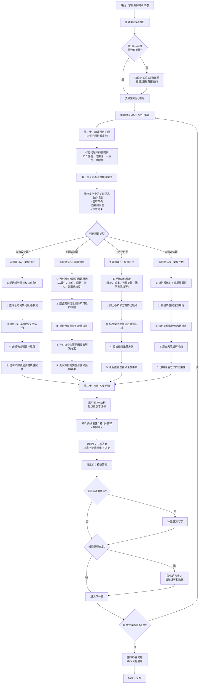

# 案例分析-必答题-技巧

## 题型
所有必答题都采用**"3个问题，总分25分"**的标准结构
- 问题1：基础理论题（质量属性识别/架构概念），分值10-12分
- 问题2：图表题（架构图填空/效用树填空），分值6-8分
- 问题3：综合应用题（架构风格适用性/场景描述/方案设计），分值7-12分

## 考点

### 从业务需求识别质量属性

熟练掌握6大核心质量属性的定义、场景描述和实现策略，能够快速准确地从需求中识别对应的质量属性
- **性能**：响应时间、并发、吞吐量、延迟、处理速度
- **可用性**：不宕机、故障自愈、降级熔断、容灾、故障恢复时间
- **安全性**：加密、防泄露、防攻击、权限、审计、隐私保护
- **可修改性**：改功能、加场景、改配置、低耦合、易迭代
- **易用性**：上手简单、操作便捷、界面友好、无需培训
- **可测试性**：易排查、可日志、可监控、可灰度
- **互操作性**：和第三方系统、ERP/CRM/外部接口对接集成
- **可移植性**：跨平台、信创适配、从一套环境迁移到另一套

### 质量属性场景六要素
- 刺激源：XX类型用户/外部系统/异常故障
- 刺激：发起XX请求/发生XX故障/高并发访问
- 制品：目标业务系统/核心服务模块
- 环境：正常运行/高峰期/故障降级场景
- 响应：系统完成XX处理、触发自愈、拒绝非法访问
- 响应度量：在X秒内完成、可用性达99.99%、零数据泄露等量化指标

### 架构风格

> 重点掌握常用架构风格的特点、优缺点和适用场景

> 高频架构风格：**分层、微服务、事件驱动、管道过滤器、仓库、解释器、REST、SOA**

#### 优点万能句式
- 架构解耦，职责划分清晰
- 可独立部署、独立扩容、迭代灵活
- 支持高并发、高可用，便于横向扩展
- 便于团队并行开发、维护成本低
- 适配复杂业务、易对接第三方系统

#### 缺点万能句式
- 架构复杂度提升，运维难度加大
- 服务间依赖多，分布式事务难处理
- 网络调用增多，延迟增加
- 对开发、运维、监控能力要求更高
- 一致性保障、故障排查难度上升

#### 适用场景万能模板
适用于**业务复杂、需求频繁变更、用户规模大、需要弹性扩容、多模块协作、后续持续迭代**的大型分布式业务系统。

#### 分布式系统架构风格选择策略
当题目涉及分布式系统场景时，架构风格的选择可结合以下思路：
- **强一致性需求**（如金融交易）→优先考虑分层+微服务+强一致性组件（ZooKeeper/Etcd）
- **高并发可用性需求**（如电商秒杀）→优先考虑事件驱动+微服务+AP组件（Eureka/Redis）
- **数据密集型需求**（如大数据分析）→优先考虑仓库/黑板+管道过滤器
- **全球分布式部署**（如跨国系统）→优先考虑微服务+事件驱动+多活架构

### 架构分层视图

通用分层万能模板：
- 接入层：负载均衡、网关、鉴权、流量控制、路由转发
- 业务服务层：核心业务逻辑、微服务模块编排
- 中台层：公共能力复用（用户、权限、流程、AI能力）
- 数据层：数据库、缓存、消息队列、知识库、存储
- 基础设施层：服务器、容器、云平台、网络、安全设备

### 4+1视图
- 逻辑视图：功能模块、子系统、业务逻辑划分
- 进程视图：并发进程、线程、服务部署运行关系
- 物理视图：硬件、服务器、机房、网络部署拓扑
- 开发视图：代码模块、包结构、工程目录、组件划分
- 场景视图：核心业务流程、用例场景，串联其他视图

### 高性能优化
1. 接入层：引入负载均衡、CDN、网关限流
2. 应用层：业务逻辑优化、接口合并、异步化处理
3. 缓存层：多级缓存（本地缓存+分布式缓存）、热点数据缓存
4. 数据层：分库分表、读写分离、索引优化、减少慢查询
5. 架构层面：微服务拆分、事件驱动异步削峰

### 高可用优化
1. 多实例集群部署，避免单点故障
2. 服务熔断、降级、限流、故障自愈
3. 异地多活、容灾备份、定时数据备份
4. 健康检查、自动扩缩容、故障自动切换
5. 关键服务冗余部署，核心链路隔离

### 安全架构优化
1. 传输安全：HTTPS、SSL/TLS、数据加密传输
2. 存储安全：敏感数据加密存储、脱敏处理
3. 访问安全：身份认证、RBAC权限控制、零信任访问
4. 防护安全：WAF、防DDOS、入侵检测、接口防刷
5. 审计安全：操作日志、行为审计、可追溯溯源

### 分布式系统特有优化策略
1. **数据一致性优化**：引入最终一致性模型，通过MQ异步补偿+定时对账保证分布式数据最终一致
2. **分布式事务优化**：避免跨服务强一致性事务，优先采用TCC/SAGA实现最终一致性，关键链路预留资源+超时回补
3. **分区容错优化**：假设网络分区必然发生，设计降级策略（如支付超时转异步、库存预扣+回补），分区恢复后通过幂等重试保证数据正确
4. **分布式缓存优化**：延迟双删+MQ异步重试保证缓存与数据库最终一致；多级缓存（本地+分布式）减少穿透；热点Key拆分避免单Key瓶颈
5. **分布式协调优化**：使用基于Raft的Etcd/Consul替代ZooKeeper，降低协调开销；服务发现采用客户端缓存+推送结合，减少注册中心压力

> **补充分布式系统核心理论**：掌握CAP/BASE理论、Raft共识算法、分布式事务模式（TCC/SAGA）、分布式ID与分布式锁

## 答题技巧
- 先看问题，再读材料
- 分点作答，每个要点一句话，阅卷好找得分点
- 套用软考标准术语，不口语化、不自创名词
- 不要过度展开，踩中关键词就给分
- 不会也不空着：套用上面模板，替换业务名词，也能拿70%分数
- 必答题三段式逻辑：
   - 先定性（是什么）
   - 再解释（为什么）
   - 再给方案（怎么做）

## 万能答题模板
  - 架构选型题："我认为应该选择XX架构风格。优点：1. XX；2. XX；3. XX。缺点：XX。在本项目中，XX需求正好匹配其优点，而其缺点可以通过XX方式规避。"
  - 问题解决题："存在的问题：1. XX；2. XX；3. XX。解决方案：1. XX；2. XX；3. XX。预期效果：XX。"
  - 技术对比题："XX技术的优点是XX，缺点是XX，适用于XX场景；YY技术的优点是XX，缺点是XX，适用于XX场景。"

## 模拟题

**【说明】**
某大型电商企业计划建设一套基于大模型Agent的智能客服系统，以替代传统的人工客服和规则式客服。系统需要支持文本、语音、图片等多种交互方式，能够处理订单查询、退换货、投诉建议等多种业务场景。系统需满足以下质量需求场景（a～m）：
a) 用户发送消息后，系统必须在2秒内给出首次响应
b) 系统能够同时支持10万以上的并发用户访问
c) 当大模型服务出现故障时，系统能够自动切换到规则式客服，保证业务不中断
d) 系统需要对用户的聊天记录和个人信息进行加密存储和传输
e) 运营人员可以在1个工作日内添加新的业务场景和知识库内容
f) 系统支持多语言界面，方便海外用户使用
g) 系统能够自动记录所有的交互过程，便于后续的审计和分析
h) 当系统负载超过80%时，能够自动扩容增加处理能力
i) 普通用户无需培训即可使用系统的基本功能
j) 系统支持与企业现有的CRM、ERP等系统进行集成
k) 系统能够在30分钟内完成故障恢复
l) 开发人员可以在2周内完成新功能的开发和上线
m) 系统需要防止恶意攻击和数据泄露

**【问题1】（12分）**
请判断上述13条系统需求对应的软件质量属性。

**【问题2】（6分）**
请补充完整下列基于大模型Agent的智能客服系统架构图。

**【问题3】（7分）**
请结合案例场景，分析该系统采用事件驱动架构风格的优势，并说明如何通过事件驱动架构提升系统的可扩展性和可靠性。

---

## 答题流程图

### 流程图使用说明

1. **时间控制是核心**：严格遵守30分钟/题的时间分配，不要在某一道题上花费过多时间
4. **结合案例**：每个要点都要结合题目中的具体场景，不要只写理论知识
5. **宁多勿少**：如果不确定答案，可以多写几个相关要点，答错不扣分
