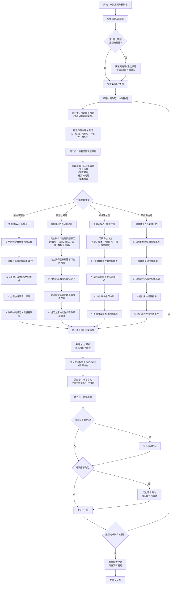

# 案例分析-必答题-技巧

## 题型
所有必答题都采用**"3个问题，总分25分"**的标准结构
- 问题1：基础理论题（质量属性识别/架构概念），分值10-12分
- 问题2：图表题（架构图填空/效用树填空），分值6-8分
- 问题3：综合应用题（架构风格适用性/场景描述/方案设计），分值7-12分

## 考点

### 从业务需求识别质量属性

> [闪卡](./模拟题/质量属性.html)

熟练掌握6大核心质量属性的定义、场景描述和实现策略，能够快速准确地从需求中识别对应的质量属性
- **性能**：响应时间、并发、吞吐量、延迟、处理速度
- **可用性**：不宕机、故障自愈、降级熔断、容灾、故障恢复时间
- **安全性**：加密、防泄露、防攻击、权限、审计、隐私保护
- **可修改性**：改功能、加场景、改配置、低耦合、易迭代
- **易用性**：上手简单、操作便捷、界面友好、无需培训
- **可测试性**：易排查、可日志、可监控、可灰度
- **互操作性**：和第三方系统、ERP/CRM/外部接口对接集成
- **可移植性**：跨平台、信创适配、从一套环境迁移到另一套

### 质量属性场景六要素

> [闪卡](./模拟题/质量属性场景六要素.html)

- 刺激源：XX类型用户/外部系统/异常故障
- 刺激：发起XX请求/发生XX故障/高并发访问
- 制品：目标业务系统/核心服务模块
- 环境：正常运行/高峰期/故障降级场景
- 响应：系统完成XX处理、触发自愈、拒绝非法访问
- 响应度量：在X秒内完成、可用性达99.99%、零数据泄露等量化指标

### 架构风格

> [闪卡](./模拟题/架构风格.html)

| 架构风格 | 优点 | 缺点 | 适用场景 |
|---|---|---|---|
| **分层架构** | 结构清晰、低耦合高内聚、易维护、便于复用、可独立扩展 | 层级过多性能损耗；跨层调用复杂；下层修改影响上层 | 通用企业系统、Web系统、操作系统、大型软件（最常用） |
| **管道‑过滤器** | 模块独立、松耦合、易复用、可并行处理、支持替换组件 | 不适合交互性强系统；数据传输开销大；不支持共享状态 | 编译器、音视频处理、日志分析、批处理、数据流式系统 |
| **仓库（知识库）架构** | 数据集中管理、共享数据方便、减少冗余；控制简单 | 中心数据瓶颈；并发访问易冲突；容错性差 | 数据库系统、CAD工具、IDE、实时监控系统、决策系统 |
| **主程序‑子程序（调用返回）** | 结构简单、逻辑清晰、易调试、执行效率高 | 紧耦合、可扩展性差、复用性弱、容错差 | 小型单机软件、嵌入式简单程序、早期单体系统 |
| **事件驱动（隐式调用）** | 松耦合、响应快、可扩展性强、支持异步、容错好 | 逻辑难调试、流程不直观、事务一致性难保证 | 物联网、监控告警、GUI系统、微服务异步通信、消息队列场景 |
| **微服务架构** | 独立部署、弹性扩展、技术栈灵活、容错性好、团队独立开发 | 运维复杂、分布式事务难、网络开销大、治理成本高 | 互联网高并发系统、大型业务系统、需要快速迭代的平台 |
| **SOA架构** | 服务复用、松耦合、异构兼容、面向业务、可集成多系统 | 架构笨重、性能一般、ESB中心化易瓶颈 | 大型政企系统、多系统集成、传统企业数字化、遗留系统整合 |
| **黑板架构** | 多源知识协同、问题求解灵活、适合模糊问题 | 调试困难、控制复杂、效率较低 | 人工智能、模式识别、医疗诊断、故障检测、专家系统 |
| **C/S（客户端/服务器）** | 交互强、响应快、可充分利用本地资源 | 客户端部署麻烦、跨平台差、维护成本高 | 桌面软件、游戏、内部业务系统、需要强交互场景 |
| **B/S（浏览器/服务器）** | 无需安装客户端、跨平台、维护简单、部署方便 | 依赖网络、交互弱、安全性相对弱 | 政务系统、管理后台、Web平台、移动端网页应用 |

### 通用分层模板

> 接叶中数鸡

> [闪卡](./模拟题/架构分层视图.html)

- 接入层：负载均衡、网关、鉴权、流量控制、路由转发
- 业务服务层：核心业务逻辑、微服务模块编排
- 中台层：公共能力复用（用户、权限、流程、AI能力）
- 数据层：数据库、缓存、消息队列、知识库、存储
- 基础设施层：服务器、容器、云平台、网络、安全设备

### 4+1视图

> 罗进开雾场

> [闪卡](./模拟题/4+1视图.html)

| 视图 | 面向 | 关注对象 | 核心内容 | 对应质量属性 |
| --- | --- | --- | --- | --- |
| 逻辑视图 | 终端用户 | 系统功能需求 | 类图、对象图、领域模型、子系统、接口 | 功能性、可修改性 |
| 进程视图 | 集成人员 | 运行时并发 | 进程、线程、同步、通信、死锁、吞吐量 | 性能、可用性 |
| 开发视图（实现视图） | 开发人员 | 代码组织 | 包、模块、库、组件、源码目录、依赖 | 可修改性、可测试性 |
| 物理视图（部署视图） | 运维/部署人员 | 硬件节点 | 服务器、容器、网络、部署拓扑 | 可用性、性能 |
| 场景视图（+1） | 所有干系人 | 用例、关键业务场景 | 用例图、业务流程；用来驱动、验证其他4个视图 | 串联全部质量属性 |

### 高性能优化

> 接应缓数架

> [闪卡](./模拟题/高性能优化.html)

1. 接入层：引入负载均衡、CDN、网关限流
2. 应用层：业务逻辑优化、接口合并、异步化处理
3. 缓存层：多级缓存（本地缓存+分布式缓存）、热点数据缓存
4. 数据层：分库分表、读写分离、索引优化、减少慢查询
5. 架构层面：微服务拆分、事件驱动异步削峰

### 高可用优化

> 多熔异健关

> [闪卡](./模拟题/高可用优化.html)

1. 多实例集群部署，避免单点故障
2. 服务熔断、降级、限流、故障自愈
3. 异地多活、容灾备份、定时数据备份
4. 健康检查、自动扩缩容、故障自动切换
5. 关键服务冗余部署，核心链路隔离

### 安全架构优化

> 传存访防审

> [闪卡](./模拟题/安全架构优化.html)

1. 传输安全：HTTPS、SSL/TLS、数据加密传输
2. 存储安全：敏感数据加密存储、脱敏处理
3. 访问安全：身份认证、RBAC权限控制、零信任访问
4. 防护安全：WAF、防DDOS、入侵检测、接口防刷
5. 审计安全：操作日志、行为审计、可追溯溯源

### 分布式系统特有优化策略

> 一致事务分区缓存协调

> [闪卡](./模拟题/分布式系统特有优化策略.html)

1. **数据一致性优化**：引入最终一致性模型，通过MQ异步补偿+定时对账保证分布式数据最终一致
2. **分布式事务优化**：避免跨服务强一致性事务，优先采用TCC/SAGA实现最终一致性，关键链路预留资源+超时回补
3. **分区容错优化**：假设网络分区必然发生，设计降级策略（如支付超时转异步、库存预扣+回补），分区恢复后通过幂等重试保证数据正确
4. **分布式缓存优化**：延迟双删+MQ异步重试保证缓存与数据库最终一致；多级缓存（本地+分布式）减少穿透；热点Key拆分避免单Key瓶颈
5. **分布式协调优化**：使用基于Raft的Etcd/Consul替代ZooKeeper，降低协调开销；服务发现采用客户端缓存+推送结合，减少注册中心压力

> **补充分布式系统核心理论**：掌握CAP/BASE理论、Raft共识算法、分布式事务模式（TCC/SAGA）、分布式ID与分布式锁

## 答题技巧
- 先看问题，再读材料
- 分点作答，每个要点一句话，阅卷好找得分点
- 套用软考标准术语，不口语化、不自创名词
- 不要过度展开，踩中关键词就给分
- 不会也不空着：套用上面模板，替换业务名词，也能拿70%分数
- 必答题三段式逻辑：
   - 先定性（是什么）
   - 再解释（为什么）
   - 再给方案（怎么做）

## 万能答题模板
  - 架构选型题："我认为应该选择XX架构风格。优点：1. XX；2. XX；3. XX。缺点：XX。在本项目中，XX需求正好匹配其优点，而其缺点可以通过XX方式规避。"
  - 问题解决题："存在的问题：1. XX；2. XX；3. XX。解决方案：1. XX；2. XX；3. XX。预期效果：XX。"
  - 技术对比题："XX技术的优点是XX，缺点是XX，适用于XX场景；YY技术的优点是XX，缺点是XX，适用于XX场景。"

---

## 答题流程图

### 流程图使用说明

1. **时间控制是核心**：严格遵守30分钟/题的时间分配，不要在某一道题上花费过多时间
4. **结合案例**：每个要点都要结合题目中的具体场景，不要只写理论知识
5. **宁多勿少**：如果不确定答案，可以多写几个相关要点，答错不扣分
