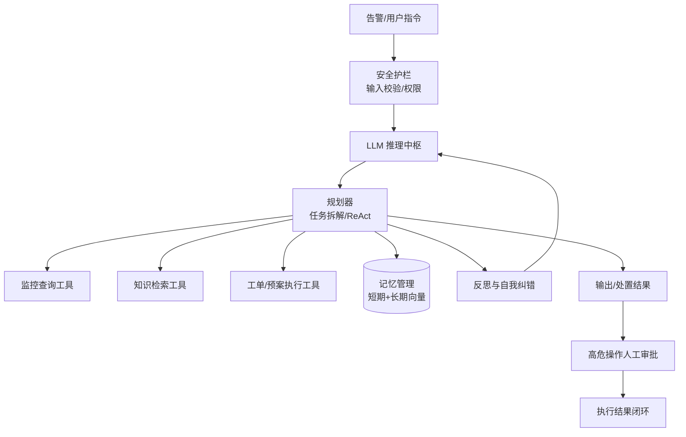
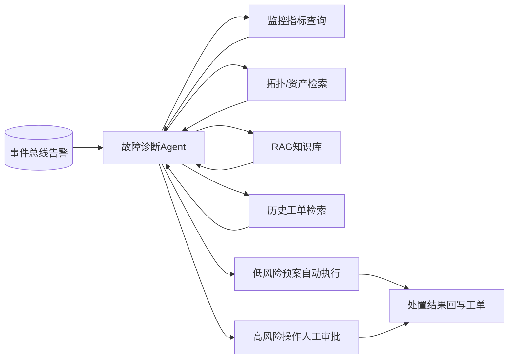

> 题目
> 
> 大模型 Agent 通过规划、工具调用、记忆管理与反思闭环，可自主完成复杂任务。请围绕你实际参与的一个项目，论述 Agent 系统的总体架构与核心组件设计（规划、工具调用、记忆、安全护栏），说明 Agent 的执行流程与终止控制、幻觉与稳定性治理方案，并给出关键技术选型理由、落地中遇到的问题及解决过程、最终效果与权衡取舍。

# 论大模型 Agent（智能体）系统的架构设计与实践

## 摘要

本文以我司“统一运维平台”智能化升级为背景，论述大模型Agent（智能体）系统的架构设计与实践。针对已有的RAG知识问答仅能被动回答问题、无法驱动跨系统故障处置的局限，作为系统架构师，我在平台落地故障诊断与处置Agent，以LLM为推理中枢，依托“感知—规划—行动—反思”闭环，调用监控查询、知识检索、工单创建、预案执行等工具，完成告警根因分析、处置方案生成与自动化处置。

本文重点阐述单Agent与多Agent选型、Agent开发框架选型、工具集设计与权限管控、幻觉与无限循环治理、人机协同等关键设计，介绍基于Langfuse的全链路可观测与评估体系。系统上线后，常见故障自助处置率提升至45%，平均故障恢复时间（MTTR）下降55%，高危操作实现零越权事故。最后总结Agent系统的适用边界、落地代价与后续演进方向。

## 一、项目背景与我的职责

平台首期基于RAG技术搭建运维知识问答模块，能够支撑运维人员查询手册、故障案例与应急预案，但整个能力属于被动问答模式。当告警发生时，运维人员仍然需要手动切换多套系统查询指标、资产拓扑，再人工创建工单、对照预案执行操作，跨系统诊断处置链路冗长，自动化程度不足。

落地过程中我们遇到三个突出痛点：
- 告警触发后人工定位根因耗时长；
- 处置方案高度依赖资深运维人员个人经验，新人上手困难；
- 涉及变更、下发指令这类写操作风险较高，直接交给模型执行存在安全隐患。

作为系统架构师，我负责第二阶段智能化模块的架构设计、技术选型与核心链路落地。经过多轮方案评审，我们决定在现有底座上升级为大模型Agent系统，让模型具备任务拆解与工具调用能力，自主完成故障诊断，同时增加安全护栏和人工审批机制管控高危操作，复用已有RAG知识库与Kafka事件总线，降低改造成本。

## 二、大模型Agent的理论分析

### 2.1 定义与核心价值

Agent是以大语言模型作为推理中枢的自主智能系统，遵循感知、规划、行动、反思的循环完成复杂目标。对比RAG只能根据检索内容回答用户提问，Agent拥有任务拆解、外部工具调用、环境交互、迭代反思的能力，适合多步骤、需要联动外部系统的执行类任务。

### 2.2 核心组件

Agent五大核心组件：LLM推理大脑负责理解目标、生成思考内容；规划器负责把复杂目标拆解成有序子任务；工具集通过Function Calling封装外部能力；记忆模块分为短期对话记忆和长期向量记忆；安全护栏负责输入过滤、权限校验、高危操作拦截。

### 2.3 关键机制与难点

主流执行范式为ReAct，推理和行动交替推进；必须设计循环终止策略，设置最大执行步数、目标判定条件，防止无限调用工具；记忆需要区分会话临时上下文和长期经验沉淀；Agent天然存在幻觉、工具误用、提示注入风险，不能完全自主运行，必须搭配安全管控与人机协同兜底。

## 三、Agent系统在本项目中的设计与实践

### 3.1 总体架构设计

我采用**单Agent+安全护栏+人机协同**架构。故障诊断Agent接收事件总线推送的告警事件，自主规划根因分析路径，依次调用监控指标查询、资产拓扑检索、RAG知识库、历史工单检索四类工具，综合信息输出诊断结论和处置方案。系统区分风险等级：查询类只读操作、低风险预案可以自动执行；涉及配置变更、指令下发等高风险写操作，强制流转人工审批，审批通过后再执行，所有调用日志、模型思考过程、处置记录统一落库审计。

### 3.2 关键设计决策

**决策1：单Agent vs 多Agent选型**

| 维度 | 单 Agent | 多 Agent |
| --- | --- | --- |
| 任务编排 | LLM内部完成步骤编排 | 多个角色Agent协商分工 |
| 安全审计 | 链路简单，边界易收敛 | 角色交互复杂，审计难度高 |
| 开发运维成本 | 较低，可控 | 高，容易出现交互失控 |
| 适配场景 | 单域流程化故障诊断 | 跨大领域复杂协同任务 |

故障诊断属于运维单域场景，流程固定，最终选用单Agent方案。

**决策2：Agent框架选型**

| 维度 | 自研 | Dify | LangChain |
| --- | --- | --- | --- |
| 私有化部署 | 完全可控 | 支持私有化 | 支持私有化 |
| 可视化编排 | 无 | 强 | 弱 |
| 二次开发灵活度 | 最高 | 中等 | 高 |
| 运维负担 | 高 | 低 | 中等 |

政务场景要求数据不出内网，兼顾交付效率，底座选用私有化Dify，自研独立工具网关统一管控调用权限。

**决策3：工具权限与幻觉治理**

工具遵循最小权限原则，网关统一鉴权、限流、日志审计；所有写操作默认走审批流。采用ReAct反思机制，设置最大10步执行上限；检索置信度不足时主动告知无法定位根因，禁止编造结论；连续多次调用失败自动降级转人工。

**决策4：可观测评估**

接入Langfuse采集每一轮的思考链路、工具调用记录、Token消耗，持续统计处置成功率、工具调用准确率、MTTR等指标，定期回归调优。

**落地反思**：上线后常见故障自助处置率提升至45%，MTTR下降55%，工具调用准确率93%，高危操作零越权事故。但Agent链路更长，推理时延和Token成本更高；输出稳定性高度依赖工具接口质量和预案文档；自主执行存在不确定性，不能替代人工，必须保留兜底通道，确定性强的场景仍然优先使用传统规则引擎。

## 四、总结

本项目落地的大模型Agent系统，打通了智能运维从知识问答到自主故障处置的能力缺口，依托LLM规划、工具调用和反思闭环，充分复用平台已有的知识库、事件总线等基础设施，在可控安全护栏的约束下，有效降低运维人员的重复工作，缩短故障处置时长。同时我们也认识到Agent架构存在明显局限，它更适合步骤明确、支持人工介入兜底的复杂查询与处置场景，并不适用于强实时、强确定性、安全零容忍的核心业务链路，盲目使用会引入不可控风险。后续我们计划逐步引入多Agent协作模式，完善长期记忆的自学习机制，搭建常态化评测流水线，持续提升Agent自主处理能力，在安全可控的前提下，进一步深化平台智能化水平。