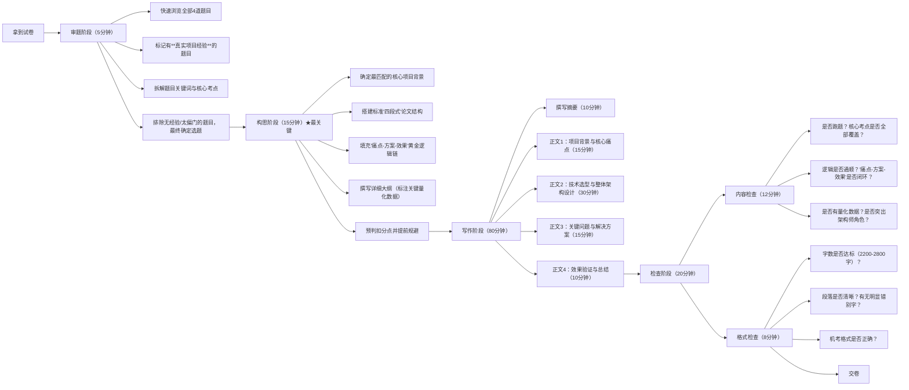

# 系统架构设计师论文题：2023-2025真题规律与2026年精准预测

## 二、核心出题规律深度总结

### 规律1：**"3+1"稳定命题结构**
每次考试的4道论文题严格遵循以下分布：
- **1道新兴技术题**（必出，占比25%）：紧跟行业最前沿，2023边云协同→2024云运维→2025事件驱动/Serverless
- **1道数据架构题**（必出，占比25%）：2023多源集成→2024 Lambda→2025多模型数据库/云原生数据库
- **1道经典架构题**（必出，占比25%）：2023 OOA→2024 SOA/分布式事务→2025负载均衡/秒杀
- **1道工程质量题**（必出，占比25%）：2023可靠性→2024单元测试/维护→2025性能测试/AI测试

### 规律2：**技术演进的"3年周期律"**
- **首次出现→深化应用→场景落地**：一个新技术从出现到成为主流考点大约需要3年
- **已考技术不会在2年内重复**：近2年考过的具体题目不会原样出现，但相关主题会以不同角度考查

### 规律3：**命题风格的三大转变**
1. **从"理论阐述"转向"问题解决"**：2023年前多问"是什么"，2023年后多问"怎么做"和"遇到什么问题怎么解决"
2. **从"通用技术"转向"场景化应用"**：2025年首次出现"秒杀场景"这种具体业务场景题，标志着命题进入新阶段
3. **从"单一技术"转向"AI融合"**：2025年上半年明确考查"AI测试用例生成"，AI与传统架构的结合成为新趋势

### 规律4：**三大永恒不变的核心考点**
1. **企业集成**：从2011到2024，企业集成平台/架构反复出现，是架构师的核心工作场景
2. **数据架构**：从分布式存储到多模型数据库，数据始终是架构设计的核心
3. **非功能属性**：可靠性、安全性、性能每隔2-3年轮动出现

## 三、2026年论文题精准预测（按概率排序）

### 第一梯队：90%以上概率出现（必准备）

#### 预测题1：论大模型（LLM）应用系统的架构设计
**预测理由**：
- 2025年AI大模型技术全面爆发，成为行业最大热点
- 2025年已考AI辅助测试、多模型数据库，命题组已向AI方向倾斜
- 大模型应用架构涉及RAG、向量数据库、Agent等丰富知识点，非常适合出论文题

**可能的论述要点**：
1. 大模型应用架构的核心组件（LLM引擎、向量数据库、RAG框架、Agent调度）
2. RAG（检索增强生成）架构设计，解决幻觉问题
3. 多模型路由与编排策略
4. 安全性与可控性设计（内容过滤、权限管控）
5. 性能优化（缓存、异步流式输出）

#### 预测题2：论可观测性架构技术的应用
**预测理由**：
- 可观测性是现代分布式系统运维的基石，行业刚需
- 历年从未直接命题，符合"新热点+未考过"的命题偏好
- 与微服务、云原生等已考技术紧密相关，考生容易找到项目经验

**可能的论述要点**：
1. 可观测性的三大支柱（日志、指标、链路追踪）
2. 可观测性架构的分层设计（数据采集层、存储层、分析层、展示层）
3. 分布式链路追踪的实现原理与技术选型
4. 可观测性在故障定位与性能优化中的应用

#### 预测题3：论数据网格（Data Mesh）架构及其应用
**预测理由**：
- 数据架构是每年必考题，2023多源集成→2024 Lambda→2025多模型数据库
- 数据网格是下一代数据架构，解决传统数据湖/仓的中心化瓶颈
- 符合"技术演进3年周期律"，2023年开始在国内普及，2026年成为考点

**可能的论述要点**：
1. 数据网格的核心原则（领域导向、数据即产品、自助式数据平台、联邦式治理）
2. 数据网格与传统数据湖/仓的区别
3. 数据网格的架构组成（数据产品、数据域、数据平台、数据治理）
4. 数据网格在企业中的实施路径与挑战

### 第二梯队：60%-80%概率出现（重点准备）

#### 预测题4：论平台工程与内部开发者平台（IDP）架构设计
**预测理由**：
- 平台工程是2025-2026年行业最热门的架构方向之一
- 解决了DevOps落地过程中的"工具碎片化"和"认知负担"问题
- 与云原生、微服务等已考技术紧密相关

#### 预测题5：论微服务架构的治理与演进策略
**预测理由**：
- 微服务是架构师的核心能力，2016和2021年已两次考查
- 现在企业普遍进入"微服务深水区"，治理和演进成为主要痛点
- 符合"3-5年重现"的周期性规律

#### 预测题6：论绿色计算架构设计
**预测理由**：
- 国家"双碳"战略推动，绿色计算成为企业IT建设的重要考量
- 2025年综合知识题已出现相关考点，论文题可能跟进
- 属于新兴且有政策导向的主题

#### 预测题7：论Web应用性能优化方法及其应用
**预测理由**：
- 性能优化是架构师的核心能力，属于"经典架构"命题槽位的常驻选手
- "Web应用性能优化"作为一个**综合性全局主题**从未被直接命题——2019年考的是"负载均衡"（子集），2025年考的是"性能测试"（测试视角≠优化视角）、"秒杀场景"（特定场景≠通用方法论）
- 符合"3-5年重现"规律：2019年"负载均衡在Web系统中的应用"→距今7年，Web性能优化作为更全面的命题条件已成熟
- 与2025年性能相关题目的**角度不同**：2025侧重"测试验证"和"特定场景"，本主题侧重"全链路优化方法论"

**可能的论述要点**：
1. Web应用性能优化的全链路分层模型（前端→网络→应用→缓存→数据库→基础设施）
2. 前端性能优化：资源压缩合并、CDN加速、懒加载、SSR/SSG、浏览器缓存策略
3. 网络层优化：HTTP/2多路复用、HTTPS优化、域名分片、TCP参数调优
4. 应用层优化：异步化处理、连接池化、线程池调优、热点代码优化
5. 缓存层优化：多级缓存架构（浏览器缓存→CDN缓存→本地缓存→分布式缓存→数据库缓存）、缓存预热、缓存穿透/击穿/雪崩防护
6. 数据库层优化：SQL调优、索引优化、读写分离、分库分表、慢查询治理
7. 架构层优化：微服务拆分、事件驱动异步削峰、无状态设计、弹性伸缩

**风险提示**：2025年已考3道性能相关论文（负载均衡+性能测试+秒杀），命题组可能认为"性能方向已充分考查"，转而选择其他方向。因此本主题优先级为**第二梯队偏下**。

### 第三梯队：30%-50%概率出现（了解即可）

1. 论服务网格（Service Mesh）架构的应用
2. 论系统安全架构设计（零信任方向）
3. 论软件系统架构演化及其应用
4. 论边缘智能系统的架构设计

## 四、2026年论文备考核心建议

1. **重点准备第一梯队的3个题目**：每个题目准备1篇完整的论文底稿，包含真实项目背景、技术方案、遇到的问题及解决方案
2. **掌握"一稿多用"技巧**：将一个核心项目经验适配到多个主题上，比如同一个企业数字化转型项目，可以分别从大模型应用、可观测性、数据网格等角度展开
3. **关注AI与传统架构的融合**：无论抽到什么题目，都可以适当加入AI技术的应用，体现对前沿技术的掌握
4. **强化场景化思维**：多准备秒杀、高并发、大数据处理等典型业务场景的解决方案
5. **第二梯队也不能忽视**：特别是"Web应用性能优化"和"微服务治理"，与第一梯队题目可共享项目素材

---

## 五、Web应用性能优化论文专属写作素材（预测题7配套）

### 1. 标准论文结构模板

**摘要（300字）**：
> 20XX年X月，我参与了某公司XX系统的建设，担任系统架构师。该系统是一个面向XX行业的Web应用平台，需支持XX量级用户并发访问。系统上线初期存在页面加载慢、接口响应超时、数据库压力大等性能瓶颈。我主导了系统的全链路性能优化工作，从前端资源优化、CDN加速、应用层异步化、多级缓存设计、数据库读写分离与索引优化等多个层面制定了优化方案。优化后，核心页面首屏加载时间从X秒降至X秒，接口P99响应时间从X毫秒降至X毫秒，数据库QPS承载能力提升X倍，系统成功支撑了XX峰值流量，运行至今稳定可靠。

**正文1 项目背景（500字）**：
> [项目时间、单位、业务场景、我在项目中的角色]
> [系统原有架构描述：技术栈、部署方式]
> [核心痛点：列2-3个最严重的性能问题，用数据说话]

**正文2 全链路性能优化方案（1000字）**：
> [分层描述优化方案，每层遵循"痛点-方案-效果"逻辑链]
> 前端优化：资源压缩→CDN→缓存策略→SSR
> 应用优化：异步化→连接池→线程池→热点接口优化
> 缓存优化：多级缓存架构设计
> 数据库优化：读写分离→分库分表→SQL调优

**正文3 关键问题与解决方案（500字）**：
> [写2-3个最具代表性的问题]
> 问题1：缓存击穿导致数据库雪崩→解决方案→效果
> 问题2：慢查询拖垮接口响应→解决方案→效果

**正文4 效果验证与总结（200字）**：
> [全部用量化数据] [反思与展望]

### 2. "痛点-方案-效果"黄金逻辑链示例

| 层级 | 典型痛点 | 优化方案 | 量化效果 |
|------|----------|----------|----------|
| 前端 | 首屏加载4.2s，JS体积1.8MB | Webpack代码分割+Tree Shaking+Gzip+CDN预热 | 首屏加载降至1.1s，JS体积降至420KB |
| 网络 | HTTPS握手增加300ms延迟 | 会话票据复用+HTTP/2多路复用+OCSP装订 | 握手耗时降至50ms，连接复用率85% |
| 应用 | 热点查询接口RT 800ms | 本地缓存+异步化+连接池调优 | RT降至120ms，吞吐量提升5倍 |
| 缓存 | 缓存命中率仅62% | 热点数据预加载+分层缓存+布隆过滤器防穿透 | 命中率提升至95%，DB查询量下降70% |
| 数据库 | 慢查询占比15%，单表5000万行 | 读写分离+按月分表+联合索引优化+慢SQL治理 | 慢查询占比降至1%，QPS承载提升4倍 |

### 3. 一稿多用适配表（Web性能优化如何改写适配其他主题）

| 目标论文题 | 项目背景调整重点 | 技术侧重点偏移 | 关键问题替换 |
|------------|-----------------|---------------|-------------|
| 论可观测性架构 | 同项目，强调"为了定位性能瓶颈" | 弱化优化方案，强化链路追踪、指标监控如何发现瓶颈 | "全链路Trace如何定位慢接口" |
| 论微服务架构治理 | 同项目，强调"从单体拆分" | 从性能视角切入拆分理由，侧重新服务治理 | "拆分后分布式事务性能如何保障" |
| 论事件驱动架构 | 同项目，强调"同步调用瓶颈" | 性能优化中的异步化→事件驱动 | "如何通过EDA实现流量削峰" |
| 论系统负载均衡 | 同项目，强调"单点瓶颈" | 深挖负载均衡策略与算法选择 | "如何处理长尾请求导致的不均衡" |
| 论分布式缓存 | 同项目，强调"数据库压力" | 深挖多级缓存设计细节 | "如何解决缓存与数据库一致性" |

### 4. 考场避坑提醒
- ❌ 不要把"性能测试"当"性能优化"写——2025年已考性能测试，再写就是跑题
- ❌ 不要只写前端优化或只写后端优化——题目的"Web应用"要求**全链路视角**
- ❌ 不要罗列技术名词没有逻辑——每个优化点都必须有"痛点-方案-效果"闭环
- ✅ 一定要写前端层——"Web应用"的前端优化是区别于"系统性能优化"的关键得分点
- ✅ 量化数据必须合理——首屏加载1-3秒、P99响应100-500ms、缓存命中率90%+等范围可信

---

# 答题技巧

# 系统架构设计师论文题：标准化答题流程与高分技巧
## 一、论文答题全流程（Mermaid流程图）

## 二、各阶段核心技巧详解
### 1. 审题阶段（5分钟）：选对题目=成功一半
- **黄金原则**：**永远选你有真实项目经验的题目，而不是看起来最简单的题目**
  - 判卷老师一眼就能看出你是否有实际经验，空洞的理论堆砌最多只能得30-40分
  - 即使题目看起来难，但只要你做过类似项目，就能写出有血有肉的内容
- **关键词拆解法**：把题目中的每个关键词都圈出来，确保论文中都有体现
  - 例："论大模型应用系统的架构设计"
    - 关键词：大模型、应用系统、架构设计
    - 核心考点：RAG架构、向量数据库、多模型编排、安全性、性能优化

### 2. 构思阶段（15分钟）：决定论文分数的上限
这是最容易被忽视但最重要的阶段，**绝对不能少于15分钟**。很多人直接动笔写，结果写到一半发现没内容或结构混乱，再改就来不及了。

- **标准"四段式"论文结构（判卷老师最认可）**：
  1. 摘要（300字左右）
  2. 项目背景与核心痛点（500字左右）
  3. 技术选型与整体架构设计（1000字左右）
  4. 关键问题与解决方案（500字左右）
  5. 效果验证与总结（200字左右）

- **"痛点-方案-效果"黄金逻辑链**：
  每个技术点都必须遵循这个逻辑：**遇到了什么具体问题→为什么选择这个方案→最终取得了什么效果**
  - ❌ 错误写法："我们使用了RAG架构来解决大模型的幻觉问题"
  - ✅ 正确写法："大模型存在幻觉问题，导致生成的客服回答准确率只有72%。我们对比了RAG和微调两种方案，最终选择RAG因为它不需要重新训练模型，更新知识更灵活。实施后，回答准确率提升到了94%"

- **大纲要包含关键量化数据**：
  在构思阶段就要把所有量化数据想好，比如项目规模、用户数、并发量、响应时间、准确率提升百分比等。这些数据是论文的"硬通货"，能极大提升可信度。

### 3. 写作阶段（80分钟）：按部就班，稳扎稳打
- **摘要五要素法**（缺一不可）：
  1. 项目背景（什么时间、什么单位、什么项目）
  2. 我的角色（系统架构设计师，负责什么工作）
  3. 核心问题（项目面临的主要架构挑战）
  4. 解决方案（采用了什么核心技术和架构）
  5. 实施效果（取得了什么量化的成果）

- **正文写作技巧**：
  - **项目背景**：不要写太多无关内容，重点突出与题目相关的业务需求和技术挑战
  - **技术选型**：一定要做对比，不能只说"我用了XX技术"，要说明"为什么不用YY技术"
  - **架构设计**：最好画出架构图（机考可以用文字描述分层结构），清晰展示各个组件的关系
  - **关键问题**：写2-3个最有代表性的问题，每个问题都要有详细的解决方案和效果
  - **效果验证**：全部用数据说话，避免"大大提升了性能"、"获得了用户好评"这种空洞的描述

- **时间分配技巧**：
  严格按照流程图中的时间分配来写，不要在某个部分花费太多时间。如果某部分写不下去，先跳过，写完其他部分再回来补。

### 4. 检查阶段（20分钟）：避免低级错误丢分
- **内容检查优先**：
  首先检查是否跑题，核心考点是否全部覆盖。如果发现跑题，还有时间进行补救，比如在摘要和总结中强调与题目相关的内容。
- **字数控制**：
  最佳字数是2500字左右，不要少于2000字（内容不充实），也不要多于3000字（时间不够，判卷老师也没耐心看）。
- **机考注意事项**：
  注意段落缩进和换行，不要一大段写到底。每段不要太长，最好控制在3-5行。

## 三、高分避坑指南
1. **不要只讲理论，不讲实践**：判卷老师想看的是你怎么做的，而不是你知道什么
2. **不要夸大其词**：数据要真实可信，不要说"系统支持1000万并发"这种不切实际的话
3. **不要写太偏门的技术**：尽量写主流技术，判卷老师不一定了解小众技术
4. **不要出现低级错误**：比如把技术名称写错，或者把架构风格搞混
5. **不要忘记突出架构师的角色**：要说明你在项目中做了哪些决策，解决了哪些问题，而不是只写团队做了什么

需要我把这个流程细化成一个**可直接套用的论文写作模板**（包含每个部分的具体句式和示例）吗？
