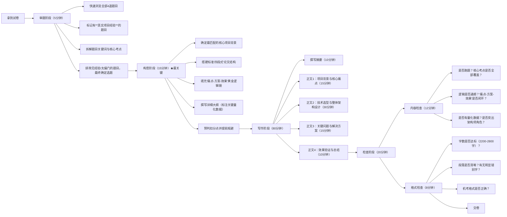

# 论文题

## 草稿

> 官方论文三道固定提问，整篇文章就是围绕这三问展开，结构完全对齐：
> 
> 问题1：简述你参与的项目、你在项目中的职责
> 
> 问题2：论述XX技术/架构的原理、特点、核心机制
> 
> 问题3：结合项目，谈你怎么落地、遇到哪些难点、怎么解决、效果、存在不足与改进方向

### 1. 摘要模板（背）300 字

本文以我集团的“统一运维管理平台”（以下简称为“平台”）项目为写作背景，阐述我在xxx领域的架构设计经验。该平台整合纳管了集团旗下数百个业务系统的资产台账、人员台账、监控数据、运维流程，以实现“统筹、集约”的目标。

在该项目中，我作为系统架构师，承担需求分析、整体架构设计、关键技术选型、跨部门技术方案评审、核心模块落地等工作。

本文围绕XXX 展开论述，首先讲解该技术的基本概念、核心组成要素、关键机制和适用场景；然后结合业务场景中的实际痛点，阐述架构设计思路；梳理方案落地过程中遇到的几个典型技术难点，对比多种备选方案，基于质量属性要求进行架构权衡与选型。最后，对平台上线后的落地效果进行介绍，同时剖析当前方案的局限和不足，并提出后续的迭代优化方向。

### 2. 第一段：项目背景 + 职责（背）450 字

2025年，我参与了我集团SSS级项目“统一运维管理平台”的建设工作。该项目为集团数字化管控重点建设项目，旨在打通下属多家子公司的异构运维系统，形成一体化管控底座。项目启动于 2025年 10月，一期建设周期为 6个月，研发团队 80人规模。

我集团旗下有多家子公司，因历史原因，各子公司独立建设了运维平台，技术栈不统一，形成大量数据孤岛；监控指标分散，故障预警滞后，跨系统问题定位困难；权限体系各自独立，账号、审计日志无法集中管理；原有单体工具扩展性弱，难以快速接入新增设备与业务系统。

因此，项目的目标是统一资源纳管、集中监控、安全审计、工单协同。平台支撑服务器、容器、中间件、网络设备、安全组件等多类型资源的统一管理，同时满足多租户隔离等硬性约束，对系统的安全性、可用性、可扩展性、可运维性提出了严苛要求。

我担任系统架构负责人，全程参与项目需求调研、总体架构方案设计、关键技术选型、跨团队方案评审，主导核心模块的架构落地与风险把控。项目整体采用云原生微服务架构，基于容器平台进行服务编排，通过统一网关实现流量接入，配套独立的权限中心、数据中台与可观测体系。

针对【替换考题对应痛点】的业务诉求，我们引入【考题主题】架构思想开展专项设计，在满足功能需求的同时，围绕多项质量属性开展架构权衡，保障平台平稳落地。以下是对架构设计的详细讲解。

### 3. 第二段：理论论述部分（🔄 动态）700 字
内容框架：
1. 概念定义
2. 核心组成/核心原则
3. 典型分类、模式
4. 优势、适用场景、局限性
5. 和其他相近方案对比（可选，加分）

ToDo

### 4. 第三段：项目落地实践、难点、方案、权衡、效果（🔄 动态） 750 字
结构：
1. 结合项目，我们针对【考题主题】的总体设计思路
2. 梳理出2～3个核心难点（固定建议写3个难点，非常稳）
3. 每个难点：方案A vs 方案B → 分析利弊、架构权衡（trade-off，必写！）→ 最终选型
4. 落地之后的量化指标（响应时间、可用性、维护成本、错误率等，数据提前预制，但解释随题目变）
5. 上线之后带来的业务收益

ToDo

### 5. 结尾：总结与展望（背）200 字

#### 版本1：云原生/架构/分布式/安全类（约195字）
本项目基于前述方案完成建设，平台已平稳上线运行，基本达成了统一运维安全管控的建设目标。但当前方案仍存在一定局限：一方面随着接入资源持续增多，治理规则复杂度不断上升，人工配置成本逐步增加；另一方面在故障自动自愈、精细化流量调度方面能力尚有不足。后续我们计划持续优化架构体系，完善可观测链路，引入自动化治理能力，在兼顾安全性与稳定性的前提下，进一步提升平台弹性与可演化能力，更好支撑集团数字化运维业务长期发展。

#### 版本2：AI/数据/RAG/大数据类（约198字）
该方案落地后，有效解决了内部资料检索、智能问答、异构数据融合等问题，满足了业务提出的智能化需求。同时我们也意识到方案存在短板：向量库更新同步机制不够灵活，大模型回答仍存在少量幻觉问题，高并发推理场景下资源开销偏高。后续我们会持续优化数据预处理与检索策略，增加答案校验环节，做好模型资源的弹性调度，在权衡响应时延、成本与准确率的基础上，持续迭代优化，赋能运维安全场景智能化升级。

***

## 答题技巧

### 一、论文答题全流程（Mermaid流程图）

### 二、各阶段核心技巧详解

#### 1. 审题阶段（5分钟）：

- **黄金原则**：**永远选你有真实项目经验的题目，而不是看起来最简单的题目**
- 拿到题目先圈出2-3个子问题，正文每个部分逐一回应
- **关键词拆解法**：把题目中的每个关键词都圈出来，确保论文中都有体现

#### 2. 构思阶段（15分钟）：决定论文分数的上限

先写大纲，包括每一部分的扣题要点
  1. 摘要
  2. 项目背景
  3. 技术方案理论论述
  4. 方案落地：难/痛点、方案、效果
  5. 结尾

#### 3. 写作阶段（80分钟）：

- **正文写作技巧**：
  - **技术选型**：一定要做对比，不能只说"我用了XX技术"，要说明"为什么不用YY技术"
  - **架构设计**：最好画出架构图（机考可以用文字描述分层结构），清晰展示各个组件的关系
  - **关键问题**：写2-3个最有代表性的问题，每个问题都要有详细的解决方案和效果
- **时间分配技巧**：
  严格按照流程图中的时间分配来写，不要在某个部分花费太多时间。如果某部分写不下去，先跳过，写完其他部分再回来补。

#### 4. 检查阶段（20分钟）：

- **内容检查优先**：
  首先检查是否跑题，核心考点是否全部覆盖。如果发现跑题，还有时间进行补救，比如在摘要和总结中强调与题目相关的内容。

