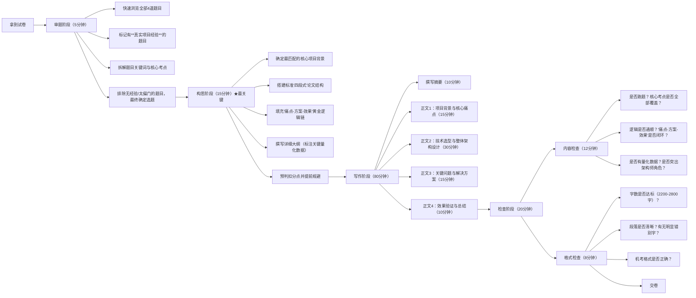

# 论文题 2023-2025真题规律与2026年精准预测

## 二、核心出题规律

### 规律1：**"3+1"稳定命题结构**

每次考试的4道论文题严格遵循以下分布：

- **1道新兴技术题**（必出，占比25%）：紧跟行业最前沿，2023边云协同→2024云运维→2025事件驱动/Serverless
- **1道数据架构题**（必出，占比25%）：2023多源集成→2024 Lambda→2025多模型数据库/云原生数据库
- **1道经典架构题**（必出，占比25%）：2023 OOA→2024 SOA/分布式事务→2025负载均衡/秒杀
- **1道工程质量题**（必出，占比25%）：2023可靠性→2024单元测试/维护→2025性能测试/AI测试

## 三、下半年论文题精准预测（按概率排序）

***

## 五、Web应用性能优化论文专属写作素材（预测题7配套）

### 1. 标准论文结构模板

**摘要（300字）**：

> 20XX年X月，我参与了某公司XX系统的建设，担任系统架构师。该系统是一个面向XX行业的Web应用平台，需支持XX量级用户并发访问。系统上线初期存在页面加载慢、接口响应超时、数据库压力大等性能瓶颈。我主导了系统的全链路性能优化工作，从前端资源优化、CDN加速、应用层异步化、多级缓存设计、数据库读写分离与索引优化等多个层面制定了优化方案。优化后，核心页面首屏加载时间从X秒降至X秒，接口P99响应时间从X毫秒降至X毫秒，数据库QPS承载能力提升X倍，系统成功支撑了XX峰值流量，运行至今稳定可靠。

**正文1 项目背景（500字）**：

> \[项目时间、单位、业务场景、我在项目中的角色]
> \[系统原有架构描述：技术栈、部署方式]
> \[核心痛点：列2-3个最严重的性能问题，用数据说话]

**正文2 全链路性能优化方案（1000字）**：

> \[分层描述优化方案，每层遵循"痛点-方案-效果"逻辑链]
> 前端优化：资源压缩→CDN→缓存策略→SSR
> 应用优化：异步化→连接池→线程池→热点接口优化
> 缓存优化：多级缓存架构设计
> 数据库优化：读写分离→分库分表→SQL调优

**正文3 关键问题与解决方案（500字）**：

> \[写2-3个最具代表性的问题]
> 问题1：缓存击穿导致数据库雪崩→解决方案→效果
> 问题2：慢查询拖垮接口响应→解决方案→效果

**正文4 效果验证与总结（200字）**：

> \[全部用量化数据] \[反思与展望]

### 3. 一稿多用适配表（Web性能优化如何改写适配其他主题）

| 目标论文题    | 项目背景调整重点         | 技术侧重点偏移                  | 关键问题替换            |
| -------- | ---------------- | ------------------------ | ----------------- |
| 论可观测性架构  | 同项目，强调"为了定位性能瓶颈" | 弱化优化方案，强化链路追踪、指标监控如何发现瓶颈 | "全链路Trace如何定位慢接口" |
| 论微服务架构治理 | 同项目，强调"从单体拆分"    | 从性能视角切入拆分理由，侧重新服务治理      | "拆分后分布式事务性能如何保障"  |
| 论事件驱动架构  | 同项目，强调"同步调用瓶颈"   | 性能优化中的异步化→事件驱动           | "如何通过EDA实现流量削峰"   |
| 论系统负载均衡  | 同项目，强调"单点瓶颈"     | 深挖负载均衡策略与算法选择            | "如何处理长尾请求导致的不均衡"  |
| 论分布式缓存   | 同项目，强调"数据库压力"    | 深挖多级缓存设计细节               | "如何解决缓存与数据库一致性"   |

***

# 答题技巧

## 零、考前准备

- 确定好要写的项目，将一个核心项目经验适配到多个主题上
- 无论抽到什么题目，都可以适当加入AI技术的应用，体现对前沿技术的掌握
- 按结构背诵固定模板，现场直接默写
  - 摘要 300 字，结构：
    - 我在 YYYY 年 MM 月做了 XXX 项目
    - 项目简介：名称、金额、历时；业务需求、问题、解决方案；本文结构概括；
    - 我做的主要工作
    - 扣题两三句
    - 项目成果
  - 项目背景 500 字，尽量通用化，只需要在最后加一段与考题相关的过渡。
    - 项目目的、业务需求、问题
    - 自己的职责
    - 项目开发周期及规模
    - 项目功能组成
  - 结尾 500 字
    - 项目上线运行效果
    - 客户评价
    - 收获
    - 不足及解决思路
    - 后续规划

- 结合项目，按结构写万能正文，或者按高频考题写几个版本，现场往考题上靠。1200 字。结构
  - 项目背景，见上
  - 核心问题分析
  - 架构设计
  - 遇到的难点痛点、解决方案、效果
  - 总体效果
  - 回应子问题

## 一、论文答题全流程（Mermaid流程图）

## 二、各阶段核心技巧详解

### 1. 审题阶段（5分钟）：选对题目=成功一半

- **黄金原则**：**永远选你有真实项目经验的题目，而不是看起来最简单的题目**
  - 判卷老师一眼就能看出你是否有实际经验，空洞的理论堆砌最多只能得30-40分
  - 即使题目看起来难，但只要你做过类似项目，就能写出有血有肉的内容
- 拿到题目先圈出2-3个子问题，正文每个部分逐一回应
- **关键词拆解法**：把题目中的每个关键词都圈出来，确保论文中都有体现
  - 例："论大模型应用系统的架构设计"
    - 关键词：大模型、应用系统、架构设计
    - 核心考点：RAG架构、向量数据库、多模型编排、安全性、性能优化

### 2. 构思阶段（15分钟）：决定论文分数的上限

这是最容易被忽视但最重要的阶段，**绝对不能少于15分钟**。很多人直接动笔写，结果写到一半发现没内容或结构混乱，再改就来不及了。

- **标准"四段式"论文结构（判卷老师最认可）**：
  1. 摘要（300字左右）
  2. 项目背景与核心痛点（500字左右）
  3. 技术选型与整体架构设计（1000字左右）
  4. 关键问题与解决方案（500字左右）
  5. 效果验证与总结（200字左右）
- **"痛点-方案-效果"黄金逻辑链**：
  每个技术点都必须遵循这个逻辑：**遇到了什么具体问题→为什么选择这个方案→最终取得了什么效果**
  - ❌ 错误写法："我们使用了RAG架构来解决大模型的幻觉问题"
  - ✅ 正确写法："大模型存在幻觉问题，导致生成的客服回答准确率只有72%。我们对比了RAG和微调两种方案，最终选择RAG因为它不需要重新训练模型，更新知识更灵活。实施后，回答准确率提升到了94%"
- **大纲要包含关键量化数据**：
  在构思阶段就要把所有量化数据想好，比如项目规模、用户数、并发量、响应时间、准确率提升百分比等。这些数据是论文的"硬通货"，能极大提升可信度。

### 3. 写作阶段（80分钟）：按部就班，稳扎稳打

- **摘要五要素法**（缺一不可）：
  1. 项目背景（什么时间、什么单位、什么项目）
  2. 我的角色（系统架构设计师，负责什么工作）
  3. 核心问题（项目面临的主要架构挑战）
  4. 解决方案（采用了什么核心技术和架构）
  5. 实施效果（取得了什么量化的成果）
- **正文写作技巧**：
  - **项目背景**：不要写太多无关内容，重点突出与题目相关的业务需求和技术挑战
  - **技术选型**：一定要做对比，不能只说"我用了XX技术"，要说明"为什么不用YY技术"
  - **架构设计**：最好画出架构图（机考可以用文字描述分层结构），清晰展示各个组件的关系
  - **关键问题**：写2-3个最有代表性的问题，每个问题都要有详细的解决方案和效果
  - **效果验证**：全部用数据说话，避免"大大提升了性能"、"获得了用户好评"这种空洞的描述
- **时间分配技巧**：
  严格按照流程图中的时间分配来写，不要在某个部分花费太多时间。如果某部分写不下去，先跳过，写完其他部分再回来补。

### 4. 检查阶段（20分钟）：避免低级错误丢分

- **内容检查优先**：
  首先检查是否跑题，核心考点是否全部覆盖。如果发现跑题，还有时间进行补救，比如在摘要和总结中强调与题目相关的内容。
- **字数控制**：
  最佳字数是2500字左右，不要少于2000字（内容不充实），也不要多于3000字（时间不够，判卷老师也没耐心看）。
- **机考注意事项**：
  注意段落缩进和换行，不要一大段写到底。每段不要太长，最好控制在3-5行。

